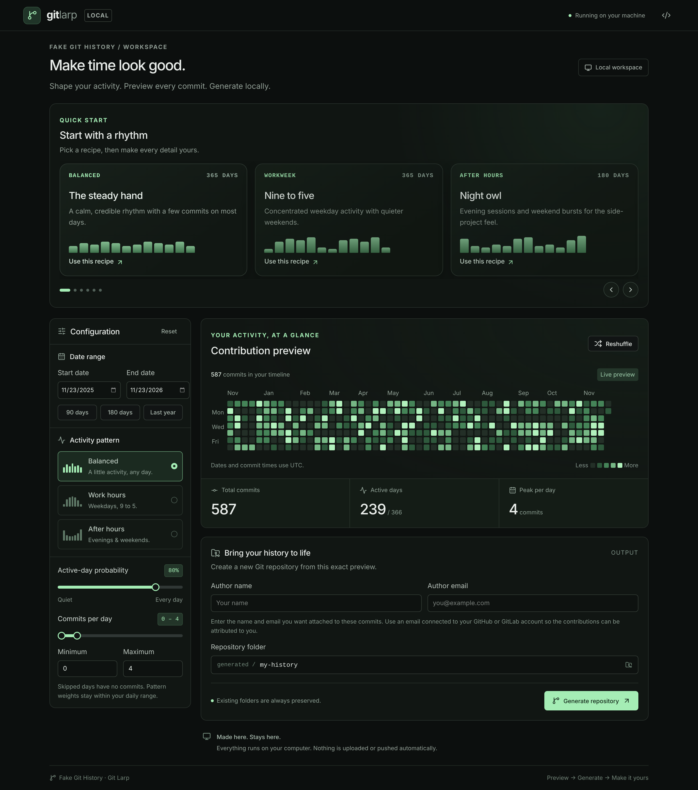

<div align="center">


# Git Larp

**Design Git activity visually. Generate a real repository locally.**

Fake Git History turns dates and activity settings into a contribution calendar. Try a 90-day Work hours plan, then switch to After hours to give weekends more weight. The local app can write every planned timestamp to a new Git repository.

[](https://github.com/ztxv/fake-git-history/actions/workflows/check.yml)


[Install](#install) &nbsp;·&nbsp; [How it works](#how-it-works) &nbsp;·&nbsp; [CLI](#cli) &nbsp;·&nbsp; [Hosted demo](#hosted-demo)

</div>

<p align="center"></p>

---

## About

A contribution calendar looks simple until you start changing the dates, density and rhythm. Git Larp gives you a studio to plan synthetic histories for demos, fixtures and Git experiments. You can see what a date range will produce before touching the filesystem.

The local web app keeps the plan you previewed and uses it to write a fresh repository of empty commits. The CLI uses the same planner for terminal previews and scripted generation.

## Features

- **Live contribution preview.** See a heatmap, total commits, active days and the busiest day.
- **Custom dates and presets.** Start from 90 days, 180 days, the last year or a named activity recipe.
- **Three activity patterns.** Adjust how likely a day is to receive commits and set the daily minimum and maximum.
- **Reshuffle.** Try a new arrangement while keeping the same date and activity settings.
- **Exact local generation.** Write the web preview's timestamps to a new repository, follow progress and cancel a running job.
- **Folder protection.** The generator rejects existing output folders.
- **Optional publishing.** Copy a GitHub CLI command for a public or private repository and run it from your own terminal.
- **Shared planner.** The hosted demo, local app and CLI use the same UTC planning logic.

## Install

You'll need Node.js **22.12 or newer** with npm, Git with support for `git init -b`, a modern browser and a writable project folder. Run `node --version`, `npm --version` and `git --version` to check.

1. Clone the repository, or choose **Code → Download ZIP** on GitHub and extract it.

   ```sh
   git clone https://github.com/ztxv/fake-git-history.git
   cd fake-git-history
   ```

2. Install the locked dependencies, build and start the local server.

   ```sh
   npm ci
   npm start
   ```

3. Open [http://127.0.0.1:3000](http://127.0.0.1:3000). Keep the terminal open while using the app and press **Ctrl+C** to stop it.

On later launches, run `npm start` again. Installation needs internet access. Local previews and generation work offline after installation.

To change the port, use `PORT=3001 npm start` in macOS, Linux or Git Bash. In PowerShell, run `$env:PORT = "3001"` and then `npm start`. Open `http://127.0.0.1:3001` afterward.

## Usage

| Control | What it does |
| --- | --- |
| **Dates** | Choose the inclusive range or use a quick date preset. The recipe carousel also sets a pattern, probability and commit range. |
| **Activity pattern** | **Balanced** (`uniform`) draws counts uniformly and favors daytime timestamps. **Work hours** (`workHours`) weights weekday counts and working hours. **After hours** (`afterWork`) weights weekends and evenings. All times use UTC. |
| **Active-day probability** | Sets the chance that a day is selected. A skipped day has zero commits. A selected day can also have zero when the range includes zero. |
| **Commits per day** | Set the allowed minimum and maximum with the sliders or number fields. |
| **Preview and Reshuffle** | Hover over or focus a calendar cell to read its date and count. Long calendars scroll inside the preview. Reshuffle uses a new seed. |
| **Author and folder** | Enter an author name and email. The web fields start blank. Choose a new output folder, then click **Generate repository**. |

The web app writes to `generated/<folder>/`. The repository has a `main` branch and empty commits named `Generated history`. Git records your supplied identity and the saved timestamps as both author and committer metadata. The working tree is empty and the result lives in `.git/`. The parent project ignores `generated/`.

### CLI

From the project root, preview a terminal graph:

```sh
npm run cli -- --preview
npm run cli -- --preview --startDate 2024/01/01 --endDate 2024/12/31 --frequency 70 --commitsPerDay "0,6" --distribution workHours
```

Omit `--preview` to write to `my-history/` in the current directory. The CLI reads `user.name` and `user.email` from Git config and picks a fresh seed on each run, so a separate generation can differ from the preview.

| Option | Alias | Default |
| --- | --- | --- |
| `--preview` | `-p` | Off. Enable it for terminal output only. |
| `--startDate` | `-s` | One year ago. Accepts `YYYY-MM-DD` or `YYYY/MM/DD`. |
| `--endDate` | `-e` | Today. Uses the same formats as the start date. |
| `--commitsPerDay` | `-c` | `0,4`. Each bound is an integer from 0 to 100. |
| `--frequency` | `-f` | `80`. Valid range is 0 to 100. |
| `--distribution` | `-d` | `uniform`. Also accepts `workHours` and `afterWork`. |

## How it works

```text
src/
  planner-core.mjs         Shared validation, seeded activity, UTC timestamps (also used by the hosted demo)
  planner.js              Node Crypto adapter for the planner
  server.js               Loopback HTTP API, retained previews and job state
  repository.js           Git commits, identity, progress and cleanup
  cli.js / index.js       Terminal flags and orchestration
  visualization.js        Terminal contribution graph
web/
  main.jsx                React controls, heatmap and generation flow
  demo.mjs                Hosted-demo stand-in for the local API (demo build only)
  style.css               Theme and responsive layout
  publish-command.mjs     POSIX-quoted GitHub CLI command
  components/             Recipes, publishing panel and local UI primitives
test/                     Planner, Git, HTTP, CLI and hosted-demo checks
```

1. **Plan.** The planner validates dates and weights the activity pattern using a seed.
2. **Preview.** The local server stores the plan and returns a preview ID, daily counts and totals. The hosted demo answers the same calls inside the browser tab instead.
3. **Generate.** The local server looks up the stored preview ID and invokes Git with an argument array. The web UI polls for job progress.

## Publishing

After generation, the local app displays the path and a copyable command for a **new** GitHub repository. Choose **Public** (the default) or **Private**. Install GitHub CLI, run `gh auth login` once, then paste the command into Bash, Zsh or Git Bash. It creates the remote, sets `origin` and pushes. Select and copy the command manually if clipboard access fails. [GitHub CLI install](https://cli.github.com/) · [`gh repo create` reference](https://cli.github.com/manual/gh_repo_create)

For another Git host or a remote you already created, open the terminal in the generated local repository and replace `YOUR_REMOTE_URL` with the URL of the empty remote:

```sh
git remote add origin YOUR_REMOTE_URL
git push -u origin main
```

GitHub and GitLab apply their own rules for contribution visibility, including commit email, branch and repository visibility. The local preview shows only the generated plan.

## Privacy and permissions

| Surface | What it accesses |
| --- | --- |
| **Hosted demo** | Runs the same interface with the local API replaced by an in-browser simulation. It reads only the settings entered in the tab, computes plans with Web Crypto and sends no requests to a backend. It saves nothing and creates no repository. It uses no account or Git credentials. |
| **Local web app** | Listens on loopback, checks Host and Origin, and requires JSON for API writes. It uses the author details entered for generation and writes Git metadata under `generated/`. The server is intended for a single local user. |
| **CLI** | Reads the configured Git name and email when generating and writes under the current directory. Preview mode only prints the graph. |
| **Publishing** | Uses your Git host and terminal credentials on request. Pushing makes the commit metadata available according to the remote repository's visibility. |

## Hosted demo

The same interface can be built as a static site that needs no server, for hosts like Vercel. The local API is replaced by an in-browser simulation in [`web/demo.mjs`](web/demo.mjs). Plans come from the real planner, so previews match the local app. Nothing is saved, and **Generate repository** plays a progress run (with working **Cancel**) but creates no repository and runs no Git.

```sh
npm run dev:demo     # try it at http://127.0.0.1:5173
npm run build:demo   # static site in dist/
```

The flag is `VITE_DEMO=true`, set by `.env.demo` for `--mode demo`. Vite replaces it at build time, so `npm run build` and `npm start` contain none of the demo code.

To deploy on Vercel, import the repository. [`vercel.json`](vercel.json) sets the install command, build command and output directory.

[](https://vercel.com/new/clone?repository-url=https%3A%2F%2Fgithub.com%2Fztxv%2Ffake-git-history&project-name=git-larp&repository-name=git-larp)

| Setting | Value |
| --- | --- |
| Root directory | Repository root (leave blank) |
| Framework preset | Vite |
| Install command | `npm ci` |
| Build command | `npm run build:demo` |
| Output directory | `dist` |
| Environment variables | None |

[Vercel build settings](https://vercel.com/docs/builds/configure-a-build)

## Development

Run the API and Vite together on ports `3000` and `5173`. Open [http://127.0.0.1:5173](http://127.0.0.1:5173) and restart the process after backend edits.

```sh
npm ci
npm run dev
```

Use these checks on Linux, macOS or WSL. One test requires `/bin/sh` and a POSIX filename. CI runs the suite and frontend build on Ubuntu.

```sh
npm test
npm run build
```

The suite exercises planner validation, equality between Node and Web Crypto planning in the hosted demo, its simulated generate and cancel flow, real Git timestamps and identity, cancellation, existing folders, HTTP generation, UTC CLI output and shell quoting. Tests use temporary repositories and a loopback server.

- `npm run start:server` serves an existing `dist/` build. Use `npm start` or rebuild if the page reports missing files or frontend edits are stale.
- If an API request fails under Vite, check that both development ports are available. If a production port is busy, set `PORT` and restart.
- If Generate is unavailable, wait for the preview, check that Git is installed and confirm the plan contains commits. Reshuffle or change a setting to refresh an expired preview. If CLI generation cannot read an identity, set Git's `user.name` and `user.email`.
- `npm run lint` runs Prettier with writes on `src/**/*.js`.

<details>
<summary><b>Known limits</b></summary>

- Inclusive date ranges run from 1 to 1,830 days. Plans can contain at most 25,000 commits. A plan with zero commits can be previewed.
- Folder names must start with a letter or number and contain 1–80 letters, numbers, hyphens or underscores. Choose a new name if a folder already exists. Cancellation and handled failures attempt to remove only the newly created partial repository. Abrupt shutdown can leave that partial folder behind.
- The local server runs one generation at a time and retains up to 20 previews (valid for 30 minutes) and 20 jobs in memory. Reloading clears the displayed form and job state. Use **Cancel** before leaving if you want to stop a running job.
- The local server has no authentication or multi-user isolation. To share a preview publicly, use the hosted demo build instead of exposing this server.

</details>

### Contributing

Open an issue first for substantial changes. Keep patches focused, run the tests and build, and include screenshots for UI changes. For new patterns, update `src/planner-core.mjs` and the web and CLI choices. The hosted demo imports the planner directly. Track lockfile changes when dependencies change. Keep generated repositories, build output and credentials out of contributions.

## Credits

Git Larp builds on [Artur Khusaenov's Fake Git History](https://github.com/artiebits/fake-git-history). The local app uses React, Vite, Tailwind CSS, Radix, Lucide and shadcn-style components. AI assisted with parts of the project.

## License

[MIT](LICENSE). Keep the copyright and license notice when redistributing copies or substantial portions of the project.

## Disclaimer

Git Larp generates synthetic activity for testing and demonstrations. It is independent of GitHub and GitLab.

<div align="center">
<sub>Built by <a href="https://github.com/ztxv">@ztxv</a>.</sub>
</div>